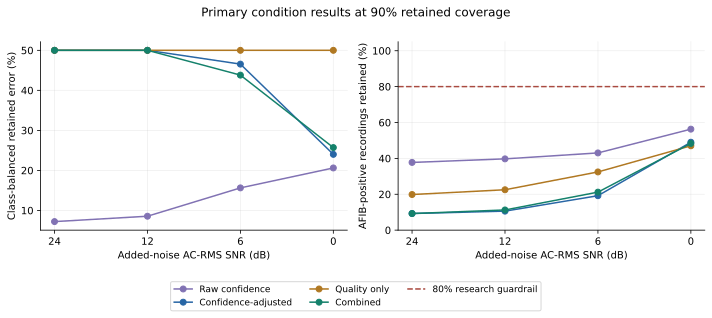

# ECG selective classification under recorded noise

**Unpublished research by Sricharan Karthigeyan. Not peer reviewed or clinically validated.**

[One-page visual brief](docs/ecg-research-brief.pdf) · [Explore the project](https://ksricharan7.github.io/portfolio/ecg.html) · [Manuscript](https://ksricharan7.github.io/portfolio/materials/ecg-manuscript-draft.pdf) · [Supplement](https://ksricharan7.github.io/portfolio/materials/ecg-supplement-draft.pdf) · [Reproduce](REPRODUCING.md)

## The question

Can waveform quality help an ECG classifier decide which predictions to retain under recorded artifact, while retaining AF-positive cases?

The key distinction is between keeping most ECG records and keeping most AF cases. In the primary 24 dB condition at 90% matched overall coverage, the combined filter retained 1,877 of 2,085 ECGs, but only 14 of 151 AF-positive records. None of those 14 retained AF cases was correctly classified as AF.

The primary combined-versus-confidence-ranker balanced retained-error difference was **−0.2635 percentage points** (95% paired participant-bootstrap CI **−2.7034 to +1.1410**). Qualified superiority was not established. A [locked replication followup](extensions/quality-replication/README.md) now tests the quality-without-predicted-class ablation across two fresh training seeds and 930 new external records. Internal gains persisted and all five new comparisons met the AF-retention criterion, but one external interval crossed zero, so the complete replication requirement was not met.

## What is reproducible here?

| Path | What it verifies | Needs ECG source data? |
| --- | --- | --- |
| Offline evidence check | File hashes, aggregate metric arithmetic, all 16 primary method/condition cells, primary effect | No; Python standard library |
| Figure regeneration | Five original primary figures from saved aggregate tables and bootstrap effects | No; NumPy and Matplotlib |
| Scientific unit checks | The original 64 synthetic/unit checks of metrics, partition guards, models and signal operations | No; scientific Python environment |
| Fixed-model primary replay | Clean + four withheld-artifact test conditions; matched-coverage and fixed-policy metrics, optional paired bootstrap | Yes; separately obtained PTB-XL 1.0.3 and NSTDB 1.0.0 |

```bash
git clone https://github.com/KSRICHARAN7/ecg-selective-classification.git
cd ecg-selective-classification
python tools/verify_release.py
```

See [REPRODUCING.md](REPRODUCING.md) for setup and commands. A successful evidence check is not independent replication of predictions. The fixed-model replay is numerical reproduction on the original test cohort, not a new untouched validation study.



In this original figure, “Quality only” denotes the original quality ranker **including predicted class**; it is not the favorable quality-without-class ablation.

## Contents

- `research/scripts/`: original frozen analysis code, copied without modification.
- `research/tests/`: original unit and synthetic checks.
- `research/config/`: scientific specifications and historical locks; no per-record pilot selection file.
- `research/models/`: fixed primary CNN checkpoint and three JSON error rankers.
- `research/outputs/`: allowlisted aggregate primary, external and robustness tables; no individual prediction arrays.
- `tools/`: public release verification and fixed-model replay adapters.
- `SOURCE_PROVENANCE.json`: original file hashes and adapter scope.
- `RELEASE_MANIFEST.json`: hashes of released files.
- `docs/`: data access, limitations and verification record.

The archived runner under `research/scripts/run_pipeline.py` reflects the original working package. Some historical stages need omitted acquisition logs, local source files and intermediate arrays. Use the documented public adapters rather than assuming every historical stage runs from a fresh checkout.

## Scope

The study cohort contains 15,292 adult human-reviewed PTB-XL ECG records from 13,796 participants. The final test set has 2,085 ECGs from 1,812 participants, including 151 AF-positive records. Lead II is extracted from clinical 12-lead recordings. The target is an AFIB annotation versus other annotated rhythms; a negative annotation does not rule out clinical AF.

No wearable validation, prospective clinical trial or clinical safety guarantee is claimed. See [limitations](docs/LIMITATIONS.md) and [data attribution](docs/DATA_ACCESS.md).

## Attribution and AI assistance

The original study and this software/research communication release were developed with GPT/Codex assistance, including coding, debugging, analysis checks, and drafting/editing. The manuscript's disclosure remains in the linked draft. This repository does not claim independent human audit or unaided authorship.

Software is available under [the MIT license](LICENSE). Provider datasets and the linked manuscript retain their own terms and are not relicensed by this repository. Trained weights are research artifacts derived from PTB-XL; dataset attribution is retained in `docs/DATA_ACCESS.md`.
