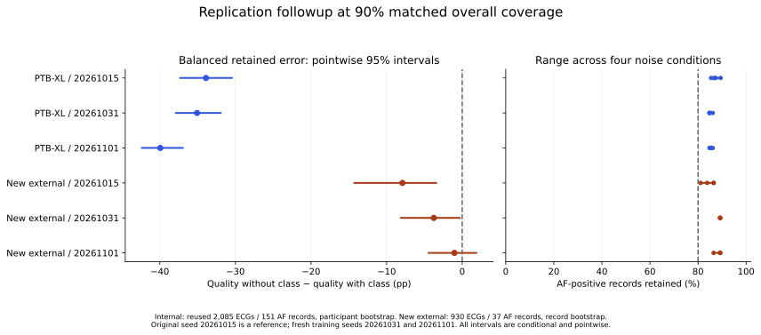

# Quality-without-predicted-class replication followup

**Result: the complete locked replication requirement was not met.** The internal seed results are favorable, and all new comparisons retain at least 80% of AF cases, but one external comparison has an interval crossing zero. The original primary experiment and manuscript remain unchanged.

[Project and explorer](https://ksricharan7.github.io/portfolio/ecg.html#replication) · [Locked plan](PLAN.json) · [Implementation clarification](AMENDMENT_01.json) · [Aggregate results](RESULTS.json) · [Automated audit](AUDIT.json)

## What was added

- Two fresh classifier training seeds, 20261031 and 20261101, using the original development recipe and roles. Both passed checkpoint/ranker gates before evaluation.
- A fixed sample of 1,000 external header paths selected without labels, excluding every original 2,000 sampled header. Of these, 930 were eligible, including 37 AF-positive records.
- All original primary methods plus the quality-without-class ablation, at 80%, 90%, 95% matched coverage and the unchanged 90% fold9 policy target.
- Paired 2,000-resample intervals: participant sampling internally; record sampling externally because reliable patient linkage is unavailable.

## Results at 90% matched coverage

Difference is quality without predicted class minus the original quality ranker **including predicted class**, averaged over em24/12/6/0. Negative favors the ablation. Intervals are pointwise, conditional on fitted models and the assigned noise library.

| Evaluation | Seed | Difference (pp) | 95% interval (pp) | Minimum AF retention | Comparison rule |
| --- | --- | ---: | --- | ---: | --- |
| Reused internal test | 20261015 | -33.90 | [-37.30, -30.47] | 85.43% | Met |
| Reused internal test | 20261031 | -35.07 | [-37.86, -31.96] | 84.77% | Met |
| Reused internal test | 20261101 | -39.94 | [-42.36, -36.96] | 84.77% | Met |
| New external sample | 20261015 | -7.91 | [-14.26, -3.44] | 81.08% | Met |
| New external sample | 20261031 | -3.76 | [-8.10, -0.32] | 89.19% | Met |
| New external sample | 20261101 | -1.03 | [-4.43, +1.87] | 86.49% | Not met |

The original-seed internal result is shown for context and is not counted as new replication. Four of the five required new comparisons met the combined interval/retention rule. The external result for seed 20261101 was −1.03 pp with 95% CI[−4.43, +1.87] pp; it cannot establish improvement for that model. All five new comparisons met the 80% AF-retention criterion.



## Compare with simpler choices

These are mean **balanced** errors across the four primary noisy conditions. Filtering methods use90% matched coverage; the unfiltered classifier retains every record. These point estimates are descriptive and are not new superiority tests.

| Evaluation | Seed | Without-class error | Unfiltered error | Raw-confidence error | Minimum raw-confidence AF retention |
| --- | --- | ---: | ---: | ---: | ---: |
| Internal | 20261015 | 16.10% | 16.66% | 13.00% | 37.75% |
| Internal | 20261031 | 14.93% | 16.57% | 24.21% | 29.14% |
| Internal | 20261101 | 10.06% | 12.26% | 28.54% | 19.87% |
| New external | 20261015 | 25.27% | 27.23% | 22.58% | 59.46% |
| New external | 20261031 | 22.05% | 24.60% | 23.08% | 56.76% |
| New external | 20261101 | 16.99% | 18.55% | 19.81% | 51.35% |

The large internal gain is relative to a quality-plus-predicted-class ranker with 50% balanced error. It is not a 35–40 pp gain over the unfiltered classifier. The tables retain all comparators and policies rather than selecting the best-looking method or seed.

## Acquisition and implementation clarification

The sampled provider headers had 46 age exclusions, 23 exclusions without an eligible rhythm code, and one header with an invalid date that the locked WFDB decoder could not parse. That malformed-header exclusion was committed before prediction evaluation. No sampled record was replaced and no raw header was repaired. All selected sources were checked against publisher hashes. There were no exact waveform duplicates within the new sample or matches with the earlier external or PTB-XL cohorts. This does not establish patient-identity disjointness.

## Interpretation limits

This is a locked followup of a posthoc finding, not a new confirmatory primary study or independent human replication. The internal test participants and NSTDB artifact source are reused. The new external records come from a previously studied dataset; the 37 AF-positive records and lack of patient linkage limit precision and independence claims. The all-comparisons requirement failed, so the ablation is not promoted as a generally validated improvement or clinical tool. The original primary failure remains.

The original 34,791-file scientific freeze was verified unchanged. The new results are an addendum; the manuscript PDFs and original explorer result controls still describe the original benchmark.

## Files and reproduction scope

`matched_metrics.csv` contains 480 aggregate rows; `fixed_policy_metrics.csv` contains 150. `RESULTS.json` includes all six model/cohort comparisons, with the original internal seed marked as context. `AUDIT.json` records independent scalar metric checks and explicit bootstrap expansion checks. No source signals, clinical headers, individual predictions or participant identifiers are published.

The two new CNNs, JSON rankers, policies and development locks are under`models/<seed>/`; the original candidate ranker is under`models/20261015/`. Fresh data-dependent fitting/evaluation scripts accept the path to the complete original working package because development caches, acquisition manifests and source datasets are omitted from the public repository. They are auditable research-source entry points, not an advertised turnkey raw-data training workflow. The original public fixed-model replay and dependency-free evidence checks remain documented in the top-level reproduction guide.

To reconstruct the external selection, obtain ecg-arrhythmia 1.0.0`SHA256SUMS.txt` directly from PhysioNet, then run:

```bash
python extensions/quality-replication/make_selection.py /path/to/ecg-arrhythmia/SHA256SUMS.txt
python extensions/quality-replication/acquire_external.py /path/to/complete-working-package
python extensions/quality-replication/fit_fresh_seeds.py /path/to/complete-working-package
python extensions/quality-replication/evaluate_replication.py /path/to/complete-working-package
python extensions/quality-replication/audit_replication.py /path/to/complete-working-package
```

Keep all generated`PRIVATE_*` files local. Existing source data and intermediate arrays are required; do not upload them to GitHub. The selection script reconstructs and excludes the original 2,000-header sample using its fixed 20261019 seed, without reading header labels.

The analysis plan was committed before fresh fitting/acquisition ([plan commit](https://github.com/KSRICHARAN7/ecg-selective-classification/commit/49be0730682ff4256b108df0121759f0cc1afabb)); the implementation was committed before prediction evaluation ([code commit](https://github.com/KSRICHARAN7/ecg-selective-classification/commit/9375793166877afcf9f611105b9771b470deef01)).
